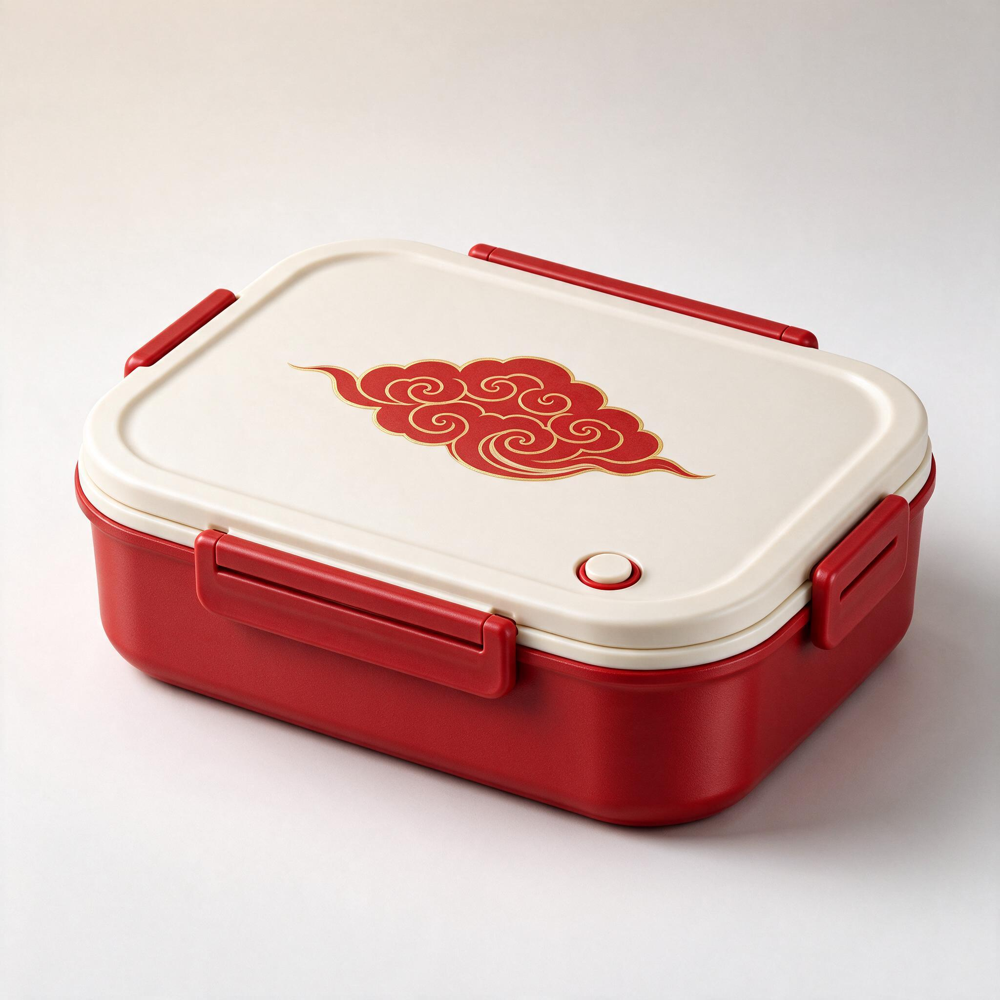
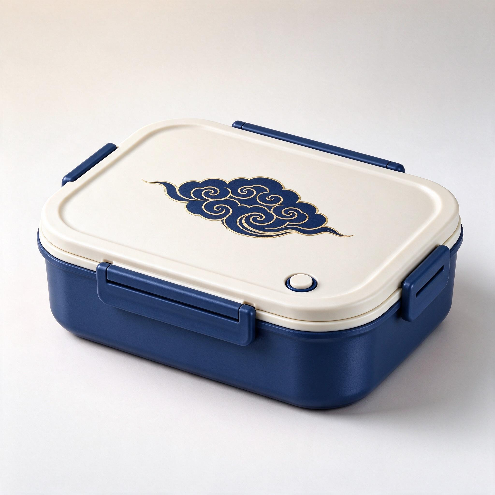
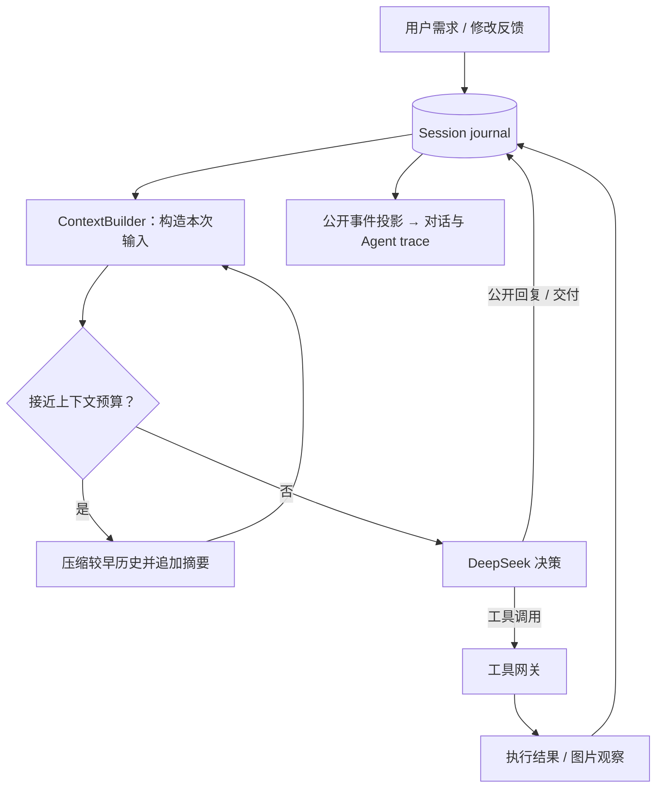

# Design Agent

**通过对话生成产品图像，并在同一个项目里持续修改。**


Design Agent 是一个面向产品效果图创作的图像 Agent。你描述目标，Agent 选择工具生成图片、查看实际结果，并根据反馈继续编辑；需要补充关键信息时，它会暂停提问，收到回答后继续。

项目使用 **DeepSeek** 进行决策与图像观察，使用 **Seedream** 生成和编辑图片，以 **LangGraph + SQLite** 保存执行进度。前端将对话、执行过程和图片结果放在同一个工作区。

[快速开始](#快速开始) · [使用方式](#使用方式) · [工作原理](#工作原理) · [配置](#配置) · [开发与测试](#开发与测试) · [架构文档](docs/ARCHITECTURE.md)

## 功能

- **对话创作**：描述产品、风格、配色和构图，由 Agent 决定生成、查看或编辑。
- **参考图迭代**：选择历史图片继续修改，保留原图、新图及父子版本关系。
- **持续会话**：同一项目保留多轮对话；刷新页面后可以继续查看历史、接收进度和回答追问。
- **自动上下文压缩**：每次模型请求从 session 构造输入，接近配置预算时压缩较早的历史，保留完整事件记录。
- **可回看的执行过程**：实时展示公开行动与工具结果，执行时展开，结束后收起；内部思考内容不返回页面。
- **项目管理**：创建、搜索和删除项目；图片支持预览与 PNG 下载，界面适配桌面和手机。
- **执行保障**：后台 worker、持久检查点、工具幂等记录与调用预算共同支持任务恢复。

## 演示

下面是一次真实的两轮创作：先生成红白国潮饭盒，再以原图为参考改成深蓝色。两轮共使用 2 次图像请求，原图与编辑结果均保留。

| 首次生成 | 参考图编辑 |
| --- | --- |
|  |  |

## 快速开始

当前安装与服务管理脚本面向 **Windows x64 + PowerShell**，已在 **Python 3.12、Node.js 24（含 npm）** 环境验证。还需要安装 Git，并准备 DeepSeek 与 Seedream 的 API 密钥。

### 1. 克隆并安装

```powershell
git clone https://github.com/5udu/design_agent.git
cd design_agent
.\scripts\setup.ps1
```

安装脚本会创建 `.venv`，安装锁定的后端依赖，并安装、构建前端。

### 2. 配置模型服务

```powershell
Copy-Item .env.example .env
```

编辑 `.env`，填入以下两个密钥，其余配置可先使用示例默认值：

```dotenv
DEEPSEEK_API_KEY=your_deepseek_api_key
SEEDREAM_API_KEY=your_seedream_api_key
```

真实对话和图像请求会调用对应供应商并产生费用。`.env` 已被 Git 忽略；示例文件只包含空密钥和默认配置。

### 3. 启动工作区

```powershell
.\scripts\start.ps1
```

- 工作区：<http://127.0.0.1:8000>
- API 文档：<http://127.0.0.1:8000/docs>

脚本在后台启动 API 和 worker；新安装首次打开时，从创建项目开始。

停止服务：

```powershell
.\scripts\stop.ps1
```

项目、会话、检查点和图片保存在本地 `data/`，重启服务后继续读取；运行日志位于 `data/logs/`。

<details>
<summary>可选：安装本地 OCR</summary>

需要核对图片中的文字时，可以安装独立的 PaddleOCR 环境：

```powershell
.\scripts\setup-ocr.ps1
.\scripts\start.ps1
```

OCR 安装脚本要求 Python 3.12 x64，使用单独的 `.ocr-venv`。首次识别会下载 OCR 模型；服务默认监听 `127.0.0.1:8766`。Agent 通过 `inspect_image` 按需选择 OCR。

</details>

## 使用方式

1. 点击「新建项目」，输入名称。品牌、产品和画面文字可选填。
2. 描述想要的图片，例如：

   > 生成一个国潮风格的饭盒产品效果图，红白配色，盒盖带祥云纹样，浅色背景，三分之四视角。

3. 查看生成结果，继续反馈：

   > 基于这张图，把红色部分改成深蓝色，保留米白色盒盖和金色纹样描边。

4. 点击任意历史图片的「基于此图修改」，将其指定为下一轮参考；也可以移除参考，提出新的创作需求。
5. 如果 Agent 发起追问，直接回答即可继续原任务。执行记录可展开重看，图片可放大或下载。

输入框支持 `Enter` 发送、`Shift + Enter` 换行。底部可选择 `off / low / high / max` 四档思考强度，默认 `max`；执行中和等待回答时沿用本轮设置。

项目列表中的删除按钮会要求确认，并删除该项目的对话、执行记录和关联图片。存在排队中、执行中或等待回答的任务时，项目不能删除。

## 工作原理

一次完整创作沿着以下路径进行：用户输入写入 session，worker 构造模型上下文，模型决定动作，工具执行并保存结果，结果再进入 session，供下一次决策与页面展示使用。



### Session、Context 与 Trace

| 组件 | 职责 |
| --- | --- |
| **Session** | 一个项目对应一个持续会话。`session_events` 按会话内递增序号追加，保存用户输入、模型消息、工具结果和状态。一次需求对应一个 run。 |
| **Context** | 每次请求从 session 投影模型输入，应用已提交的摘要，加入工具定义与本轮配置。工具调用和对应结果保持完整配对。 |
| **Agent trace** | 前端从公开事件生成的执行视图，按 run 和工具调用归并；通过 SSE 接收进度，刷新后从快照与游标接续。 |
| **Checkpoint** | LangGraph 保存当前执行位置及必要控制状态，支持后台执行和追问恢复。模型历史由 session 提供。 |

自动压缩只改变后续模型请求使用的上下文，完整历史和 trace 仍然保留。私有模型消息用于服务端上下文重建，不通过 API 或 SSE 返回内部思考内容。

### 五个工具

| 工具 | 用途 |
| --- | --- |
| `read_project` | 读取项目信息、当前参考图与历史图片索引 |
| `generate_image` | 根据目标生成完整图片 |
| `edit_image` | 基于明确的参考图执行编辑，保存引用关系 |
| `inspect_image` | 查看实际图片，需要核对文字时可调用 OCR |
| `ask_user` | 请求关键信息并暂停，收到回答后继续 |

Agent 在通用的模型与工具循环中选择下一步动作。默认每轮最多 16 次模型决策、3 次图像提交；图片提交状态未知时会保留记录，避免盲目重复提交。

实现细节见 [架构说明](docs/ARCHITECTURE.md)。

## 配置

配置从根目录 `.env` 读取，完整示例见 [.env.example](.env.example)。修改服务配置后需要重启服务。

| 变量 | 默认值 | 说明 |
| --- | --- | --- |
| `DEEPSEEK_API_KEY` | 空 | DeepSeek API 密钥 |
| `DEEPSEEK_BASE_URL` | `https://api.deepseek.com` | 决策模型服务地址 |
| `DEEPSEEK_MODEL` | `deepseek-flash` | 决策与图像观察模型 |
| `DEEPSEEK_REASONING_EFFORT` | `max` | 新任务的默认思考强度 |
| `SEEDREAM_API_KEY` | 空 | Seedream API 密钥 |
| `SEEDREAM_BASE_URL` | `https://ark.cn-beijing.volces.com/api/v3` | 图像服务地址 |
| `SEEDREAM_MODEL` | `doubao-seedream-5-0-flash-260915` | 图像生成与编辑模型 |
| `MAX_MODEL_STEPS` | `16` | 单轮模型决策上限 |
| `MAX_IMAGE_CALLS` | `3` | 单轮图像提交上限 |
| `OCR_URL` | `http://127.0.0.1:8766` | 可选 OCR 服务地址 |

<details>
<summary>上下文预算与压缩配置</summary>

| 变量 | 默认值 | 说明 |
| --- | --- | --- |
| `CONTEXT_WINDOW_TOKENS` | `1000000` | 应用配置的上下文窗口 |
| `CONTEXT_OUTPUT_RESERVE` | `384000` | 为输出预留的预算 |
| `CONTEXT_SAFETY_TOKENS` | `16384` | 安全余量 |
| `CONTEXT_COMPACT_RATIO` | `0.8` | 压缩触发比例 |
| `CONTEXT_RETAIN_TOKENS` | `32768` | 压缩时保留的近期消息预算 |
| `CONTEXT_SUMMARY_MAX_TOKENS` | `4096` | 摘要输出上限 |

上述数值是本项目的默认配置，切换模型时应按目标模型能力调整。压缩触发阈值取「窗口减去输出预留与安全余量」和「窗口乘压缩比例」中的较小值。当前 token 用量为本地估算。

</details>

## 开发与测试

以下命令从项目根目录运行。

```powershell
# 后端离线测试
.\.venv\Scripts\python.exe -m pytest backend/tests -q

# 前端事件投影测试与生产构建
npm --prefix frontend test
npm --prefix frontend run build
```

当前验证包含 **81 项后端测试、6 项前端测试**，覆盖工具调用、任务恢复、思考强度、会话迁移、上下文压缩、事件投影与项目删除。离线测试使用本地替身。

前端开发可在后端服务运行时另开终端执行：

```powershell
npm --prefix frontend run dev
```

Vite 会输出开发地址，`/api` 请求代理至 `127.0.0.1:8000`。

<details>
<summary>运行完整页面回归</summary>

需要安装 Microsoft Edge 和 Playwright：

```powershell
.\.venv\Scripts\python.exe -m pip install playwright
.\.venv\Scripts\python.exe scripts/verify_session_workspace.py
```

脚本使用临时数据目录、独立端口和本地模型/图像替身，验证生成、参考编辑、询问恢复、自动压缩、项目删除、多页面同步及移动端交互，不产生付费 API 请求。结果写入 `outputs/session-context/`。

</details>

## 项目结构

```text
backend/
  app/
    agent/          主控指令、模型循环与图像观察
    session/        会话事件、历史投影与迁移
    context/        请求构造、预算估算与自动压缩
    tools/          五个工具的定义、注册和实现
    runtime/        worker、执行网关与结果保存
    providers/      DeepSeek、Seedream 与 OCR 适配
    persistence/    SQLite、文件与项目清理
    domain/         领域模型
    main.py         FastAPI 接口
  tests/            后端离线测试
frontend/
  src/              React 对话工作区与事件投影
  tests/            前端事件投影测试
scripts/            安装、启动、停止与页面验证
docs/               架构说明与演示图片
```

本地生成的 `data/`、`outputs/`、虚拟环境、依赖目录和构建产物均不纳入版本控制。

## 当前边界

- 当前运行方式为本机 API、单 worker 与 SQLite，面向本地使用；未实现多用户认证和服务端多租户隔离。
- 整图编辑可能改变非目标区域，图片中的文字、Logo 与产品细节需要实际核对。
- 上下文压缩依赖模型摘要，存在信息损失；超长且无法在预算内整理的输入会明确失败并保留原始记录。
- 当前示例和测试验证了执行机制与特定创作案例，尚未进行广泛图像质量或长期记忆质量评测。

## 文档与参考

- [架构说明](docs/ARCHITECTURE.md)：Agent 循环、会话、上下文、事件与持久执行。

README 的组织方式参考了 [Open Deep Research](https://github.com/langchain-ai/open_deep_research) 与 [Dexter](https://github.com/virattt/dexter) 的项目介绍、快速开始、配置和测试章节；本页内容以本仓库实现为准。
