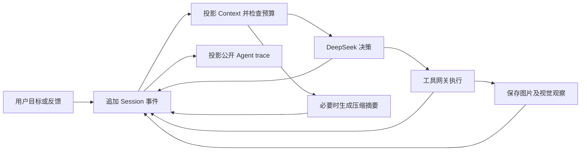

# 图像生成与编辑 Agent 架构

更新日期：2026-11-03。项目提供项目列表和对话工作区，交付完整产品效果图，并支持通过后续对话编辑或重新生成。

## 1. 产品目标

用户提供图像目标，Agent交付真正对应的图片。例如国潮饭盒应展示饭盒本体、造型、透视与光照，不能用纸盒正面、插画素材或可编辑文档替代。

## 2. 界面

左侧管理项目，右侧展示完整对话。输入框、执行过程、结果图片位于同一工作区。新项目只需名称；品牌、产品与画面文字选填，不要求用户先补齐设计表单。

每轮有独立trace：执行时展开，结束或等待用户时收起，用户可以重看公开行动、工具输入输出与图片观察记录。trace从会话事件投影，整理模型上下文不删除trace。内部思维链仅存于服务端私有模型消息，不通过API或SSE返回。

输入框底部提供off、low、high、max四档思考强度，默认max并记住用户偏好。执行及等待回答期间锁定选项，trace记录该轮实际档位，结束后可调整下一轮。

## 3. 主控与执行循环

LangGraph负责决策与工具节点的调度、检查点与中断恢复。检查点只保存run_id、steps、待执行calls及结束标志；模型历史统一从session派生，请求边界由journal中的request_prepared记录。业务方法由模型根据用户目标与真实结果选择，没有按产品名称或案例编号选择固定流程的路由。

agent/graph只处理通用决策循环和消息协议，五个工具均通过runtime/gateway调用tools中的实现。具体工具不在graph或gateway中以工具名分支展开。图片视觉消息放在agent/observations，任务结束和交付结果保存放在runtime/results。

每轮reasoning_effort由API保存到run，主模型的全部工具决策及重启恢复都沿用该值。DeepSeek适配器把off映射为thinking.type=disabled并省略reasoning_effort；其余档位启用thinking并提交low/high/max。缺省使用服务配置，不改变共享模型实例的默认值。参数依据[官方接口说明](https://api-docs.deepseek.com/guides/thinking_mode/)。

## 4. 五个工具

| 工具 | 能力 |
| --- | --- |
| read_project | 读取已知信息、当前指定图片和历史图片索引 |
| generate_image | 生成一张完整图片，按目标选择宽高比 |
| edit_image | 基于明确参考图与反馈编辑，保存原图与引用关系 |
| inspect_image | 再次获取实际图片；只在需要核对文字时选择OCR |
| ask_user | 关键目标缺失或存在冲突时提问并等待 |

当前模型为DeepSeek V4.1 Flash与Seedream Flash。图像请求默认1:1，可选4:3、3:4、16:9、9:16、7:10。供应商接口与图像数据适配在providers中。

工具实现分别位于tools/project.py、tools/images.py和tools/user.py，每个定义绑定参数、说明与执行函数。tools/registry统一注册，并生成供模型使用的参数定义；同一注册表供网关查找执行函数。

## 5. Session、Context与Agent trace

一个项目对应一个持续session，一次用户需求对应一个run，一次模型决策对应一个step。继续对话与回答追问都写入同一session；询问恢复继续原run。当前不提供会话分叉功能。

| 层 | 内容与责任 |
| --- | --- |
| Session journal | SQLite的session_events是消息事实来源，按session内递增seq追加；记录run_id、step_id、call_id、来源及幂等key |
| 公开事件 | 用户消息、助手公开说明、工具参数与结果、图片观察、状态、压缩过程；供历史页面与SSE读取 |
| 私有模型消息 | 保留原始role、tool_calls、tool结果、reasoning_content及图片引用；供ContextBuilder投影，不返回前端 |
| Context | 每次请求从journal生成活跃消息，应用已提交摘要，加入工具schema和该run配置；本身不是另一份持久聊天历史 |
| Agent trace | 前端纯投影：同一run/call_id的开始、等待、提交和结果更新同一个工具节点；公开进展与最终答复通过phase区分 |

正常路径是保存用户输入及运行背景，worker准备context，模型回复落入journal，网关执行工具并原子保存工具状态与结果事件；整批工具结果补齐后，再记录图片观察，进入下一次模型请求。工具调用及结果保持完整配对，恢复时复用已接受的模型决策和已有工具结果。

每次请求记录request_prepared，包含through_seq、活跃消息seq、模型、思考强度、工具schema及输入估算。按through_seq重放journal可重建当次消息；图片引用在发送前校验摘要并还原为真实图片输入。预览以内容摘要命名保存在data/previews，避免在事件或检查点中反复保存Base64。

### 自动compact

ContextBuilder在每次模型调用前检查预算。触发阈值取“窗口减去输出预留与安全余量”和“窗口乘压缩比例”中的较小值。选取较早的完整消息单元生成摘要，保留当前system、本轮用户输入和运行背景、当前最新图片及最近消息。assistant工具调用与对应结果整体保留或整体压缩。

摘要请求关闭思考、不提供工具，明确区分用户要求与助手建议，保留资产/版本标识和未完成事项，不传入私有reasoning_content。成功后追加context_compacted，记录covered_seqs、摘要、用量及前后估算；原事件和图片保持原样。空摘要、截断、变长或调用失败均不替换历史；仍超硬预算则明确结束本轮，避免静默截断。供应商明确报告窗口溢出时，强制整理并仅重试一次。

默认配置见.env.example：窗口1,000,000、输出预留384,000、安全余量16,384、比例0.8、最近保留32,768、摘要上限4,096。文本按UTF-8长度估算，图片另按尺寸估算，尚未集成供应商精确tokenizer；大于单次摘要窗口的历史块会明确失败并保留记录。压缩摘要存在信息损失，离线测试只验证机制，不代表真实模型的长期记忆质量已评测。

### 图片产物

图片保存为 `product_render`。参考编辑记录reference_asset_id与父版本，原图不会覆盖。当前轮若先生成后修复，主交付显示叶子结果；早期图片仍可在trace中追溯。多个独立方向可同时交付。

画面中的Logo、文字由整图模型生成，无法承诺逐像素锁定或零生图改字。

## 6. 持久执行

FastAPI保存任务，单worker执行，SQLite保存项目、资产、版本、工具、session事件及LangGraph控制检查点。关闭页面不取消模型任务。新打开项目后完整历史继续显示，当前图可作为下一轮参考。

默认最多16轮模型决策、3次图像请求。远端提交状态未知时保留unknown，不盲目重发。文件检查和视觉要求是否满足分别记录，不将“接口成功”当作全部质量通过。

图像工具通过注入的提交函数调用供应商，预算检查与submitted记录在网关执行。ask_user的中断信号继续由LangGraph处理，网关不会将它记为工具失败；恢复后沿用原调用记录，不重复发送请求或重复展示开始事件。

旧events表在事务中一次性导入journal，有旧检查点时提取本轮实际消息；缺少检查点时只导入已保存的用户输入、回答和摘要，不伪造工具协议。导入完成删除旧表和conversation_context字段，重复启动不重复迁移。等待任务缺少检查点时，将未配对工具明确标为中断，记录已保存的问答，在新step继续；已有图片提交记录仍限制重复请求。

## 7. API与前端关系

项目详情可包含conversations、session与快照cursor。GET /api/sessions/{session_id}返回公开事件快照；GET /api/sessions/{session_id}/events按session的seq推送，支持after和Last-Event-ID。前端先加载快照，再从cursor接续，按session_id/seq去重；等待回答和任务结束不关闭会话订阅。

新任务通过target_asset_id指定参考图，版本关系由后端推导，后端验证素材归属。前端不规定下一项工具，通过journal投影trace，终态重新获取交付资产。没有旧的按run订阅事件接口。

图片可直接下载PNG与放大预览。选中历史图片后可继续修改；移除参考图后可提出全新需求。

DELETE /api/projects/{project_id}删除项目及其session、任务、工具记录、资产、版本和对应LangGraph检查点。排队、执行中和等待回答的任务会阻止删除；项目锁覆盖worker的完整执行及检查点收尾，防止终态刚写入就被删除后又补回检查点。入队和创建session在同一事务内验证项目仍存在，延迟请求不能复活已删除项目。

原图和未被其他会话引用的预览进入持久file_cleanup队列，删除后尝试清理；被占用的文件在后续启动或删除时重试。清理只允许data/assets、data/previews中的文件，保留仍被其他项目引用的路径；预览写入与回收通过锁协调。其他页面订阅的SSE会收到project_deleted并切换项目。删除最后一个项目后，服务重启不自动重建默认项目。

## 8. 指令与执行边界

instructions.py仅保留SYSTEM；每轮保存实际指令版本，活跃context使用最新一份system。它规定完整图片交付、参考选择、视觉反馈和事实边界；具体生图prompt由主模型写入工具参数后传给Seedream。代码强制执行图片归属与完整性校验、调用预算及未知提交不重发。

## 9. 当前验收与质量验证

验证覆盖图片归属、不可变原图、参考关系、预算、未知提交、询问恢复、四档思考强度、跨轮session、上下文投影、自动压缩及trace重放。隔离页面回归使用本地模型和图片替身，触发压缩后验证刷新、参考编辑、询问恢复和移动端。测试运行方式见[开发与测试](../README.md#开发与测试)。

当前只实际验证了国潮饭盒生成与改色，不能外推为所有产品、风格和编辑保留能力。后续评估应增加不同产品、参考保持、文字准确性与主观偏好的独立样例。
