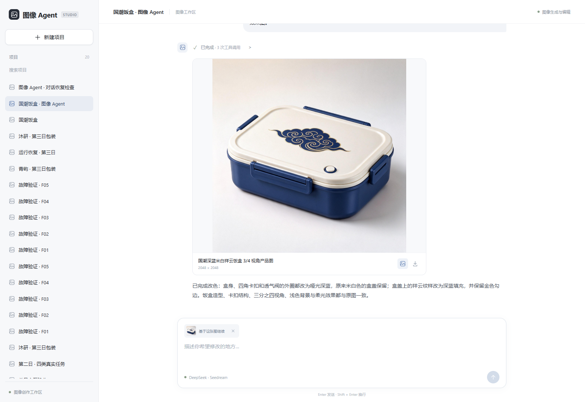
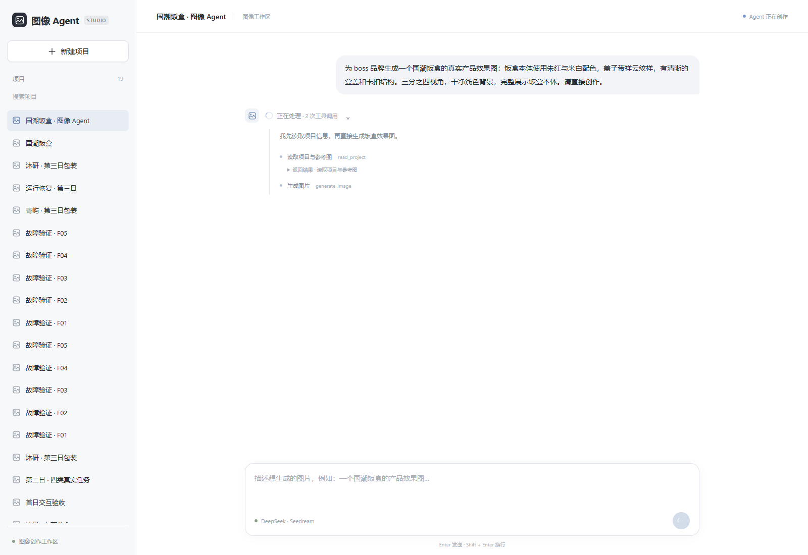

# 图像 Agent 调整记录

日期：2026-11-03。

按最新要求，产品形态改为专用于图像生成与编辑的Agent，交付完整图片。旧分层包装模式及配套代码已删除，清理范围见[CLEANUP.md](CLEANUP.md)。

## 本次改动

1. 前端改为左侧项目列表、右侧连续对话。图片、执行过程和输入都在同一个工作区，移除主流程中的独立画布、版本管理表单与分层控制面板。
2. 每轮对话显示Agent trace，执行时自动展开，结束或等待时收起，可手动重看行动与工具输入输出；显示公开执行记录。
3. 结果为真实产品效果图。输入“国潮饭盒”后交付可辨识饭盒本体、盒盖、卡扣、纹样与光照的完整图片。
4. 反馈在同一对话里继续，Agent自主决定参考编辑或重新生成。当前参考图会出现在输入框；也可选旧图继续修改或移除参考提出新需求。
5. 新项目只需名称，品牌、产品和画面文字改为选填，取消必须填写批准文案的门槛。

## 真实验证

[打开国潮饭盒演示](http://127.0.0.1:8000/?project=94e0eacc343046f88464fd58d66a0f9a)。

- 初次任务：读取项目 → 生成红白祥云饭盒 → 收到实际图片后结束。run_id：`7efc4655f7cb42588157c890f4f19b25`。
- 反馈任务：读取项目 → 查看图片 → 参考编辑为深蓝 → 收到实际新图后结束。run_id：`78d3e5e499df4fc1a877dbfbe7592122`。
- 两轮共2次真实图像请求，均交付2048×2048 PNG。原图保留，编辑稿记录reference_asset_id与父版本。
- 另用真实模型验证询问、等待时刷新、回复后继续，未调用图像模型。run_id：`6f22bfd3d7ea4da499af890c1582e9fc`。
- 本机Edge验证trace自动展开/收起、手动重看、完整对话刷新恢复、PNG下载、图片放大、指定旧图为参考、移除参考和移动端布局，无页面错误。
- 思考强度调整阶段的46项功能离线检查通过。新增前端四档思考强度及任务级持久化，前端生产构建通过；此前历史真实对话页面重放和数据保留记录仍保留，未新增付费图像请求。后续session、context与trace改造的当前结果见[验收范围](ACCEPTANCE.md)。

[红白原图](evidence/image-agent/red-lunchbox.png) · [深蓝编辑结果](evidence/image-agent/blue-lunchbox.png)

## 源码与记录

主控指令与模型循环位于agent，工具定义和实现位于tools，执行保障与结果保存位于runtime，图片文件校验位于persistence。前端主组件为Workspace.tsx与AgentTrace.tsx。结构见[项目结构](PROJECT_STRUCTURE.md)。

初次任务、工具轨迹、图片与页面截图在outputs/image-agent；其中evidence.json及tests.xml是当时版本的快照。清理验证见outputs/cleanup，模块化回归见outputs/modularization，最新思考强度测试和页面联调见outputs/reasoning-effort，未覆盖原始调用记录或将其冒充本次新增生图评测。

内置浏览器连接仍无法读取页面，本次采用本机独立Edge测试，未操作用户已有浏览器会话。

## 当前边界

本次验证的是实际饭盒生成与改色、多轮上下文和trace交互，不是广泛图像质量评测。整图编辑可能改变非目标细节，图中文字与Logo准确性需实际核对。
